# Continuous Integration and Continuous Delivery (CI/CD) Architecture

- **Author & Lead:** Adeel Ahmad (Registration ID: 443057803)
- **Role:** Application Testing & CI/CD Lead
- **Project:** Department Information Service
- **Repository:** `https://github.com/keitakeitala75-arch/devops-system-service`
- **Workflow File:** [`.github/workflows/ci.yml`](file:///C:/Users/adeel/.gemini/antigravity/scratch/devops-system-service/.github/workflows/ci.yml)

---

## 1. Overview and Core Philosophy

The CI/CD pipeline automates the complete verification, static analysis, containerization, and artifact archiving process for every proposed code change. Built on GitHub Actions, the pipeline enforces **Shift-Left Quality Assurance**: code issues, styling discrepancies, and logic errors are identified and halted automatically before merging or container generation can occur.

### Key Objectives
1. **Automated Verification:** Every commit and pull request targeting `main` is tested in an isolated Ubuntu container.
2. **Quality Gatekeeping:** Unit test failures or linting violations immediately abort the pipeline, preventing defective code from progressing to Docker image compilation.
3. **Traceable Artifacts:** Passing builds produce a versioned, compressed Docker image archive tagged with the 7-character Git commit SHA, retained for 30 days.
4. **Reproducibility:** A standardized environment (Python 3.14 on `ubuntu-latest`) guarantees identical test and build results across all development environments.

---

## 2. Pipeline Triggers

The workflow triggers on the following GitHub events:

```yaml
on:
  push:
    branches: [main]
  pull_request:
    branches: [main]
```

- **Pull Requests targeting `main`:** Enables peer reviewers and contributors to see test and lint results before a merge is approved.
- **Pushes to `main`:** Verifies the integrated codebase after a merge commit, creating the official release artifact.

---

## 3. Step-by-Step Pipeline Execution Breakdown

The workflow runs under a single orchestrated job, `test-and-build`, on `ubuntu-latest`:

```mermaid
flowchart LR
    A[1. Code Checkout] --> B[2. Python 3.14 Setup]
    B --> C[3. Install Dependencies]
    C --> D[4. Pytest Execution]
    D --> E[5. Flake8 Static Linting]
    E --> F[6. Docker Image Build]
    F --> G[7. Export & Compress Image]
    G --> H[8. Upload CI Artifact]

    style D fill:#e1f5fe,stroke:#0288d1
    style E fill:#e1f5fe,stroke:#0288d1
    style F fill:#e8f5e9,stroke:#388e3c
    style H fill:#fff3e0,stroke:#f57c00
```



### Stage 1: Checkout Source Code
```yaml
- name: Checkout source code
  uses: actions/checkout@v4
```
Clones the exact Git revision triggered by the event into the GitHub Actions runner.

### Stage 2: Set Up Python Runtime
```yaml
- name: Set up Python
  uses: actions/setup-python@v5
  with:
    python-version: "3.14"
```
Configures Python 3.14 in the virtual runner environment, matching the project's target deployment runtime.

### Stage 3: Dependency Installation
```yaml
- name: Install dependencies
  run: |
    python -m pip install --upgrade pip
    pip install -r requirements.txt
```
Upgrades `pip` and installs application requirements (`Flask`, `gunicorn`, `pytest`, `flake8`).

### Stage 4: Automated Test Execution (Quality Gate 1)
```yaml
- name: Run application tests
  run: python -m pytest -v
```
Executes all unit and integration tests under `tests/test_app.py`. If any assertion fails, the step exits with code `1` and terminates the pipeline immediately.

### Stage 5: Static Code Quality Check (Quality Gate 2)
```yaml
- name: Check code quality
  run: flake8 app tests
```
Runs Flake8 to enforce PEP 8 styling, variable scope correctness, and clean imports across application and test source code. Any violation terminates the pipeline before container building.

### Stage 6: Build Docker Container Image
```yaml
- name: Build Docker image
  run: |
    docker build -t devops-service:${GITHUB_SHA::7} .
```
Builds the container using the non-root `Dockerfile`, tagging the image with the first 7 characters of the Git commit SHA (e.g., `devops-service:ba54c85`).

### Stage 7: Export and Compress Docker Image
```yaml
- name: Save Docker image
  run: |
    docker save devops-service:${GITHUB_SHA::7} | gzip > devops-service.tar.gz
```
Serializes the container image filesystem and layers into a portable `.tar.gz` archive.

### Stage 8: Upload CI Artifact
```yaml
- name: Upload Docker artifact
  uses: actions/upload-artifact@v4
  with:
    name: devops-service-${{ github.sha }}
    path: devops-service.tar.gz
    retention-days: 30
```
Persists the compiled image archive in GitHub Actions storage for 30 days, creating a verifiable release artifact linked directly to the commit SHA.

---

## 4. Failure Blocking Mechanism (The "Quality Gate")

The CI pipeline guarantees that **unverified code never produces a deployment artifact**. 

Because GitHub Actions terminates the job on the first non-zero exit status:
1. If a test assertion in `tests/test_app.py` fails $\rightarrow$ Stage 4 exits with code 1.
2. If code formatting in `app/` violates Flake8 $\rightarrow$ Stage 5 exits with code 1.
3. Stages 6, 7, and 8 (Docker build, image save, and artifact upload) are **completely skipped**.
4. The pull request is marked with a red cross ($\times$), blocking automated deployment and informing reviewers of the defect.

```
[Pytest / Flake8 Pass]  ──> [Docker Image Build] ──> [Upload devops-service.tar.gz] (SUCCESS)
[Pytest / Flake8 Fail]  ──X [Pipeline Aborted]    ──X [No Artifact Generated]       (FAILED)
```

---

## 5. Artifact Traceability Model

Every deployed container in production or staging can be traced back to the exact developer, pull request, and source revision:

| Dimension | Identifier Example | Verification Method |
|---|---|---|
| **Git Commit SHA** | `ba54c85` | `git show ba54c85` |
| **Pull Request** | PR #4 (`feature/adel-work`) | `https://github.com/.../pull/4` |
| **CI Workflow Run** | Run ID `44491703371` | `https://github.com/.../actions/runs/44491703371` |
| **Image Archive** | `devops-service-<full-sha>.tar.gz` | Downloaded from CI Run Artifacts |
| **Container Image Tag** | `devops-service:ba54c85` | `docker images devops-service` |
| **Running Service** | Reports version `1.1.0` | `curl -s http://localhost:5000/info` |

---

## 6. Demonstration of Failure, Correction, and Success

Per course assessment requirements, the pipeline's failure-blocking behavior is documented below:

### Scenario: Broken Test or Syntax Defect
1. **Defect Injected:** A developer updates `tests/test_app.py` with an erroneous expected string or introduces an unused import in `app/app.py`.
2. **Pipeline Trigger:** Pull request created or commit pushed.
3. **Failure Result:** GitHub Actions flags `Check code quality` or `Run application tests` with exit code 1. The job aborts in under 20 seconds. No Docker artifact is produced.
4. **Correction:** Developer resolves the issue locally, confirms pass via `python -m pytest -v && python -m flake8 app tests`, and pushes the fix.
5. **Success Result:** GitHub Actions executes all 8 stages, produces green checkmarks, builds `devops-service:<sha>`, and uploads the verified artifact.

---

## 7. Local vs. CI Verification Commands

Developers can run the exact commands used by the CI pipeline locally before pushing:

```bash
# 1. Run unit and integration tests
python -m pytest -v

# 2. Run static code analysis
python -m flake8 app tests

# 3. Test Docker build locally
docker build -t devops-service:local .
```
