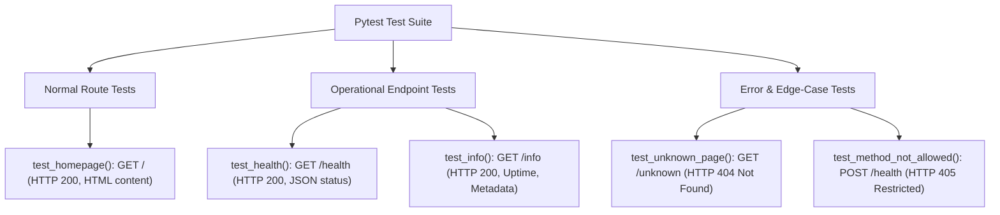

# Application Testing Strategy & Quality Assurance Guide

- **Author & Lead:** Adeel Ahmad (Registration ID: 443057803)
- **Role:** Application Testing & CI/CD Lead
- **Project:** Department Information Service
- **Test File:** [`tests/test_app.py`](file:///C:/Users/adeel/.gemini/antigravity/scratch/devops-system-service/tests/test_app.py)
- **Framework:** Pytest 8.4+ / Python 3.14

---

## 1. Testing Philosophy & Scope

Quality Assurance in the Department Information Service follows a strict **Automated Verification First** strategy. Every release candidate is evaluated against automated unit tests, endpoint validation, error handling, edge cases, and static code quality analysis.

The test strategy satisfies all project rubric requirements:
- Normal output verification.
- Dedicated `/health` check verification.
- Runtime metadata and `/info` verification.
- Edge case and error handling verification.
- Static analysis and code style adherence.

---

## 2. Test Suite Anatomy (`tests/test_app.py`)

The test suite contains 5 comprehensive test functions executing against the Flask application test client:



### Detailed Test Case Breakdown

#### 1. `test_homepage()` — Normal Route Verification
- **Purpose:** Verifies the user-facing homepage rendered by `GET /`.
- **Validation Criteria:**
  - HTTP Status Code: `200 OK`
  - Body contains service name: `"Department Information Service"`
  - Body contains support email: `"support@example.com"`
  - Body contains application version string: `"Application Version:</strong> 1.1.0"`

```python
def test_homepage():
    client = app.test_client()
    response = client.get("/")

    assert response.status_code == 200
    assert b"Department Information Service" in response.data
    assert b"support@example.com" in response.data
    assert b"Application Version:</strong> 1.1.0" in response.data
```

#### 2. `test_health()` — Health Probe Verification
- **Purpose:** Validates the automated health monitoring endpoint at `GET /health`.
- **Validation Criteria:**
  - HTTP Status Code: `200 OK`
  - JSON payload key `"status"` equals `"healthy"`
  - JSON payload key `"version"` matches expected release `"1.1.0"`

```python
def test_health():
    client = app.test_client()
    response = client.get("/health")

    assert response.status_code == 200
    assert response.json["status"] == "healthy"
    assert response.json["version"] == "1.1.0"
```

#### 3. `test_info()` — Runtime Metadata & Operational Verification
- **Purpose:** Validates the runtime metadata and telemetry endpoint at `GET /info`.
- **Validation Criteria:**
  - HTTP Status Code: `200 OK`
  - JSON payload key `"status"` equals `"operational"`
  - JSON payload key `"version"` equals `"1.1.0"`
  - JSON payload key `"app_name"` equals `"Department Information Portal"`
  - JSON payload key `"environment"` equals `"production"`
  - JSON payload key `"support_contact"` equals `"support@example.com"`
  - JSON payload key `"uptime_seconds"` is an integer and $\ge 0$

```python
def test_info():
    client = app.test_client()
    response = client.get("/info")

    assert response.status_code == 200
    assert response.json["status"] == "operational"
    assert response.json["version"] == "1.1.0"
    assert response.json["app_name"] == "Department Information Portal"
    assert response.json["environment"] == "production"
    assert response.json["support_contact"] == "support@example.com"
    assert isinstance(response.json["uptime_seconds"], int)
    assert response.json["uptime_seconds"] >= 0
```

#### 4. `test_unknown_page()` — Negative Route / Error Handling
- **Purpose:** Verifies that unmapped or malicious URL requests receive proper HTTP 404 responses without leaking stack traces.
- **Validation Criteria:**
  - Request to `GET /unknown` returns HTTP Status Code: `404 Not Found`

```python
def test_unknown_page():
    client = app.test_client()
    response = client.get("/unknown")

    assert response.status_code == 404
```

#### 5. `test_method_not_allowed()` — Security & Edge-Case Method Restriction
- **Purpose:** Verifies that non-permitted HTTP methods (such as `POST` to read-only endpoints like `/health`) are safely rejected.
- **Validation Criteria:**
  - Request to `POST /health` returns HTTP Status Code: `405 Method Not Allowed`

```python
def test_method_not_allowed():
    client = app.test_client()
    response = client.post("/health")

    assert response.status_code == 405
```

---

## 3. Static Code Analysis (Flake8)

In addition to dynamic testing, static analysis inspects source code quality without running the application.

### Flake8 Checks Enforced:
1. **PEP 8 Compliance:** Proper indentation (4 spaces), blank line separation (2 lines between top-level functions), whitespace rules.
2. **Line Length Limit:** Maximum 79 characters per line.
3. **Syntax & Undefined Variables:** Detects undefined variables, unimported modules, or typos.
4. **Clean Imports:** Flags unused imports to keep container bundles minimal and prevent dead code.

---

## 4. Local Execution Guide

To run tests and code analysis locally:

```bash
# Activate virtual environment
source .venv/bin/activate  # On Linux/macOS
# .venv\Scripts\Activate.ps1  # On Windows

# Install requirements
pip install -r requirements.txt

# Run all automated tests with verbose output
python -m pytest -v

# Run Flake8 static code quality check
python -m flake8 app tests
```

### Expected Test Output
```text
============================= test session starts =============================
platform ... pytest-8.4.2 ...
collected 5 items

tests/test_app.py::test_homepage PASSED                                  [ 20%]
tests/test_app.py::test_health PASSED                                    [ 40%]
tests/test_app.py::test_info PASSED                                      [ 60%]
tests/test_app.py::test_unknown_page PASSED                              [ 80%]
tests/test_app.py::test_method_not_allowed PASSED                        [100%]

============================== 5 passed in 0.16s ==============================
```
